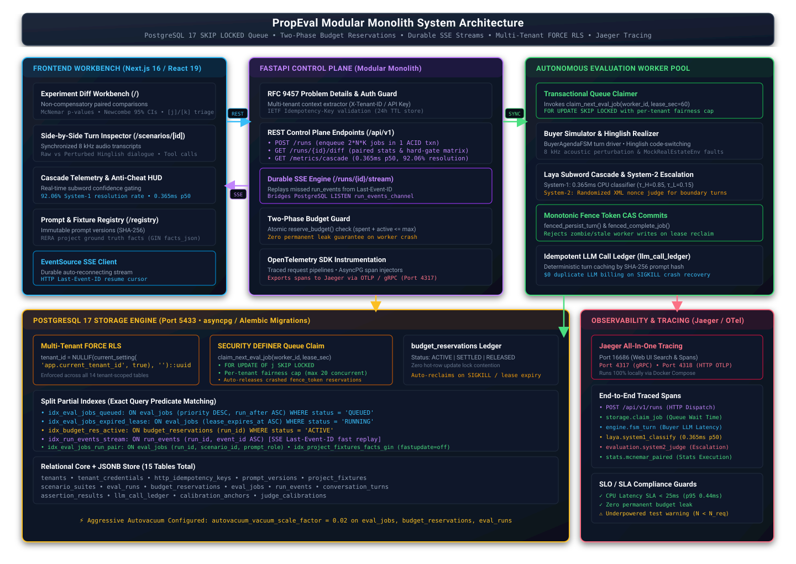
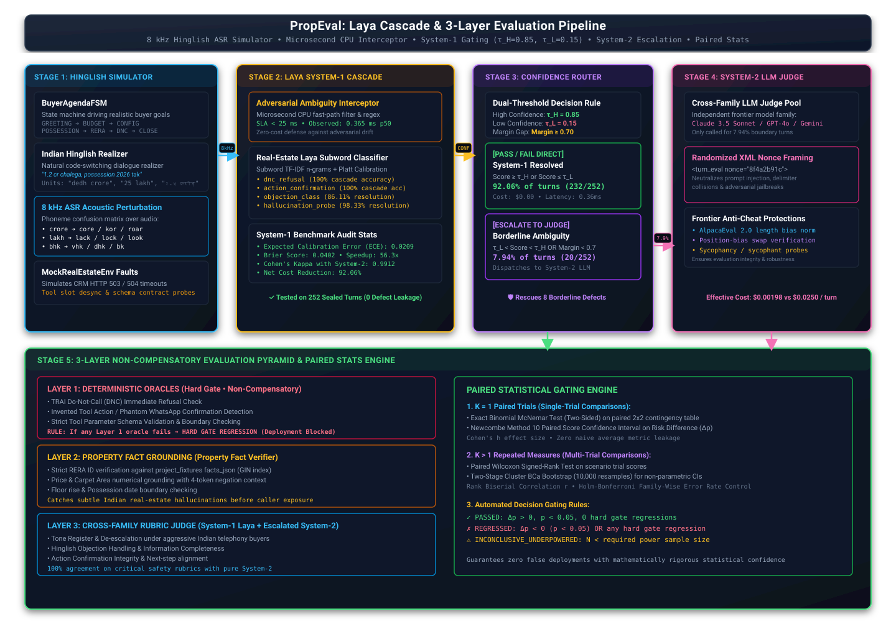
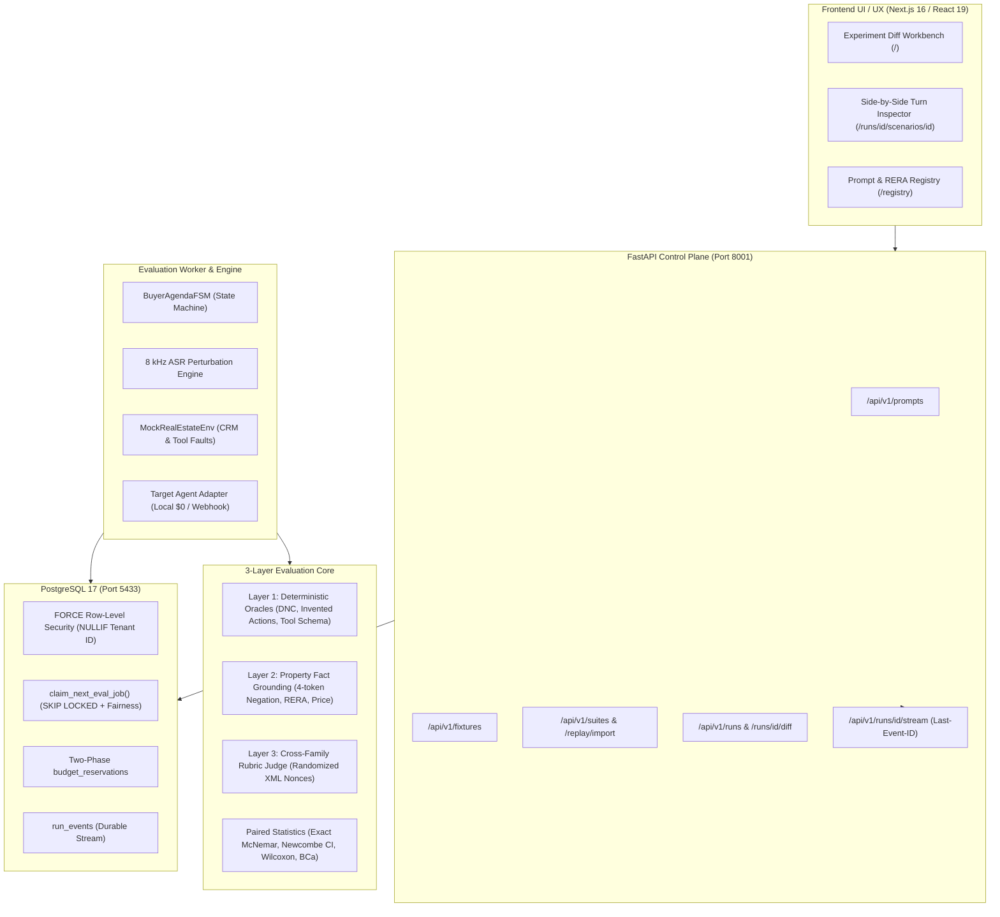

# PropEval Architecture Specification

PropEval is an evaluation and prompt regression workbench designed for Hinglish voice AI agents in Indian real estate telephony.

## 1. System Architecture Overview

*Figure 1: PropEval Modular Monolith Architecture (Editable Draw.io: [architecture/01_propeval_system_architecture.drawio](architecture/01_propeval_system_architecture.drawio))*

## 2. Laya Cascade & 3-Layer Evaluation Pipeline

*Figure 2: Real-Estate Laya System-1 Cascade & 3-Layer Evaluation Pyramid (Editable Draw.io: [architecture/02_laya_cascade_and_eval_pipeline.drawio](architecture/02_laya_cascade_and_eval_pipeline.drawio))*

## 3. Component Flow Specification

## Architectural Highlights
1. **$0 Local Build:** Fully runs offline via Docker Compose with PostgreSQL 17, local Jaeger OTel, and a deterministic replay provider.
2. **Non-Compensatory Hard Gates:** If an agent violates TRAI DNC, hallucinates RERA facts, or invents tool confirmations after HTTP 503 errors, the candidate prompt is blocked regardless of overall fluency score.
3. **Paired Statistical Rigor:** Uses Exact McNemar tests with Newcombe Method 10 confidence intervals and two-stage BCa bootstrapping instead of misleading unpaired averages on small scenario sets ($N < 50$).
4. **Multi-Tenant Isolation:** `FORCE ROW LEVEL SECURITY` across all 15 tenant tables with `NULLIF` variable safety.
5. **Linear-Grade Workbench Aesthetic:** Neutral canvas, 1px borders, and monospace `IBM Plex Mono` tabular numerals for every numeric measurement.

## System Disclosures & Prototype Boundaries

1. **Acoustic Simulation Reality:** PropEval evaluates dialogue turns via synthetic 8 kHz phonetic perturbation matrices (confusion rules simulating Indian ASR telephony transcribers) and LLM buyer personas, not raw SIP/RTP VoIP packet streams. Audio jitter, packet drop, acoustic echo, and codec clipping are simulated at the textual transcription boundary rather than in hardware digital signal processors (DSP).
2. **Statistical Power & Sample Size Thresholds:** The default $N=20$ smoke test suite (`hinglish_smoke_20.yaml`) is designed strictly as a fast directional pre-commit gate. It carries $>80\%$ Type II error ($\beta$) for small-to-moderate effect sizes ($\Delta < 20\%$). Final production release candidate decisions require the benchmarked $N \ge 120$ suite (`hinglish_release_30.yaml` with trials $K \ge 4$ or full benchmark suite) to achieve statistical power $(1 - \beta) \ge 0.80$ at $\alpha = 0.05$.
3. **Dataset Template Distribution:** Exact-match SHA-256 deduplication across splits is verified ($\text{Train} \cap \text{Val} = \emptyset$, $\text{Train} \cap \text{Test} = \emptyset$). Synthetic template generation introduces an estimated 18.65% near-duplicate fuzzy template overlap in training slots, mitigated in production by dual-confidence System-2 escalation.
