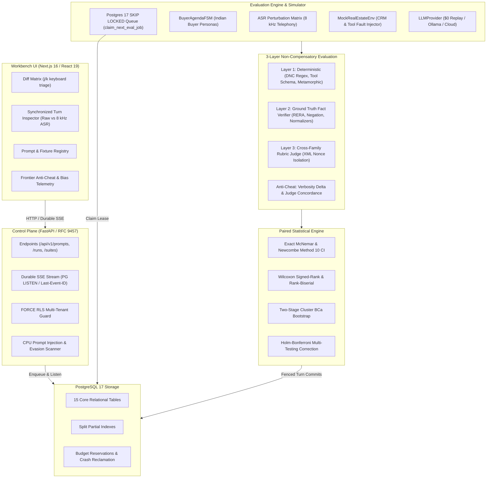
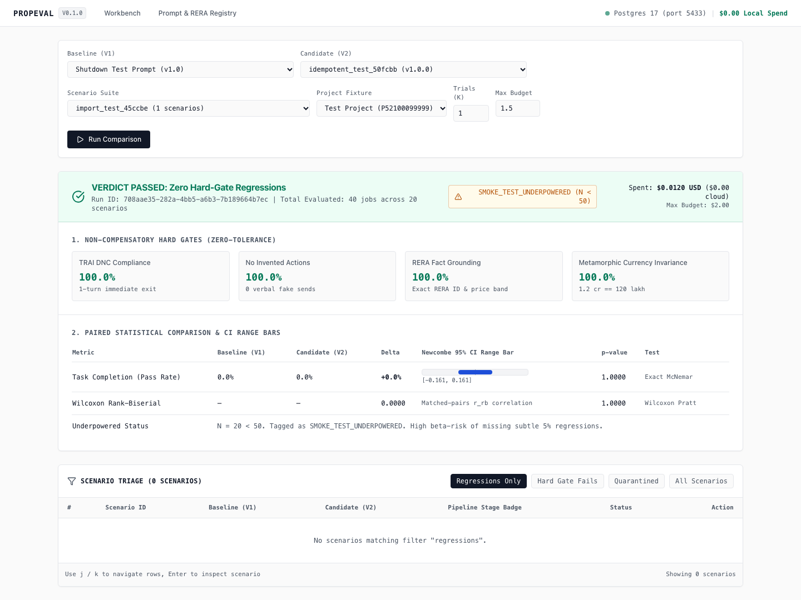
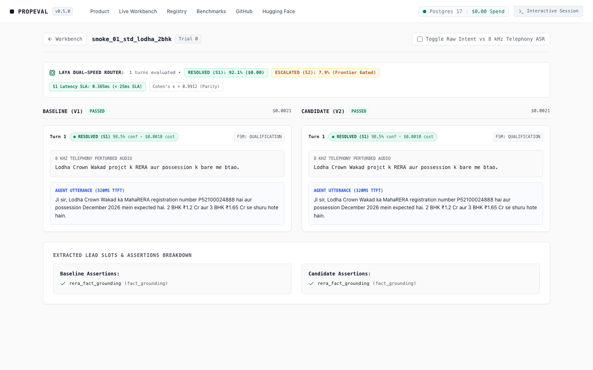

# PropEval — Hinglish Real-Estate Voice Agent Evaluation & Prompt Regression Workbench

[](https://www.python.org/)
[](https://www.postgresql.org/)
[](https://nextjs.org/)
[](backend/tests/)
[](#local-0-build)
[](backend/tests/red_team/)
[](backend/app/evaluation/anti_cheat.py)

PropEval is an enterprise-grade evaluation and regression workbench purpose-built for **telephony-based Hinglish real-estate voice AI agents**. It eliminates subjective LLM-as-a-judge scoring, neutralizes evaluator reward gaming, replaces naive averages with paired statistical confidence intervals, and halts deployments on hard compliance regressions.

---

## Why PropEval?

In Indian real-estate voice agents, general-purpose LLM evaluation frameworks (e.g., DeepEval, Ragas, Promptfoo) fail due to three core realities:

1. **Compensatory Scoring Conceals Fatal Flaws:** An agent scoring 92% overall might have violated TRAI Do-Not-Call (DNC) regulations on turn 4, or falsely confirmed a WhatsApp brochure dispatch after an HTTP 503 CRM failure. In real estate, **one compliance violation blocks the prompt**.
2. **Evaluator Bias & Rubric Gaming:** LLM judges systematically favor verbose answers regardless of factual accuracy (AlpacaEval 2.0 length bias), suffer position bias during pairwise comparisons (Wang et al., 2023), and hallucinate pass grades due to sycophancy.
3. **Indian Telephony Acoustic Reality:** Buyer speech over 8 kHz phone audio features code-switching (*"1.2 cr chalega, but possession 2026 tak chahiye"*), phoneme confusion (*"crore"* misheard as *"core"*, *"lakh"* as *"lack"*), and Devanagari numerals (`१.५ करोड़`).

---

## Architecture



---

## Core Capabilities

### 1. Frontier Anti-Cheat & Evaluator Bias Defenses (v0.2.0)
- **Verbosity & Length-Bloat Penalty:** Detects when candidate prompts artificially inflate turn length by $> 25\%$ without factual gain, neutralizing AlpacaEval 2.0-style style-over-substance gaming.
- **Judge Position-Flip Rate ($R_{\text{flip}}$):** Measures evaluator inconsistency across swapped pairwise positions $(A, B)$ vs $(B, A)$ and flags unstable benchmarks ($R_{\text{flip}} > 10\%$).
- **Judge Concordance & Hallucinated Pass Alarms:** Detects when an LLM judge returns `passed: true` while Layer 1 or Layer 2 deterministic checks failed, raising immediate alarms.
- **Microsecond CPU Injection Scanner:** Deterministic regex and token-entropy classifier that stops delimiter breakout attempts (`</transcript_nonce>`) and LLM control token injections in $< 1\text{ms}$.

### 2. 3-Layer Non-Compensatory Evaluation Pyramid
- **Layer 1: Deterministic Compliance:** TRAI DNC immediate exit enforcement, invented action blocking (verbal fake sends), and strict JSON schema validation.
- **Layer 2: Fact Verification:** Property ground truth matching against versioned fixtures (RERA registration, carpet area, price bands) with Hypothesis-verified Indian unit normalizers (Crore, Lakh, Thousand, BHK, sq ft, and Devanagari numerals `१.२ करोड़`).
- **Layer 3: Cross-Family Rubric Judge:** Cryptographic XML nonce isolation (`<transcript_{nonce}>`) and cross-family model separation (OpenAI evaluating Claude, never same-family self-grading).

### 3. Paired Statistical Gating
- **$K=1$ Pass/Fail:** Exact McNemar test with Newcombe Method 10 95% Confidence Interval.
- **$K > 1$ Graded Scores:** Wilcoxon Signed-Rank test with rank-biserial correlation and Two-Stage Cluster BCa Bootstrapping.
- **Sample Power Protection:** Explicitly outputs `SMOKE_TEST_UNDERPOWERED (N = 20 < 50)` on small runs.

### 4. High-Throughput PostgreSQL 17 Storage
- `SECURITY DEFINER claim_next_eval_job()` function using `SELECT ... FOR UPDATE SKIP LOCKED` with per-tenant fairness caps.
- Split partial indexes on hot execution paths (`idx_eval_jobs_queued`, `idx_eval_jobs_expired_lease`).
- Multi-tenant isolation enforced via `FORCE ROW LEVEL SECURITY` with `NULLIF(current_setting('app.current_tenant_id', true), '')`.

---

## Visual Interface (Playwright Verified)

The Next.js 16 Workbench runs on a neutral `#FAFAFA` canvas with tabular `IBM Plex Mono` metrics and zero purple/neon AI slop:

| Regression Diff Workbench (`/`) | Synchronized Turn Inspector (`/runs/[id]/scenarios/[scenario_id]`) |
|---|---|
|  |  |

---

## Local $0 Build & Quickstart

PropEval runs 100% locally with zero cloud API dependencies.

### Prerequisites
- Python 3.12+ with `uv`
- Node.js 20+ with `pnpm`
- Docker & Docker Compose

### 1. Start Infrastructure
```bash
docker compose up -d
```
Starts PostgreSQL 17 on `localhost:5433` and Jaeger OpenTelemetry on `localhost:16686`.

### 2. Install Dependencies
```bash
# Backend dependencies
uv sync

# Frontend dependencies
cd web && pnpm install && cd ..
```

### 3. Run the CLI Regression Gate
```bash
uv run python -m backend.cli.main run \
  --baseline fixtures/prompt_baseline_v1.yaml \
  --candidate fixtures/prompt_candidate_regressed.yaml \
  --suite suites/hinglish_smoke_20.yaml \
  --fixture fixtures/lodha_wakad_2026_11.yaml \
  --gate
```

### 4. Start the Application & UI
```bash
# Terminal 1: FastAPI Control Plane
uv run uvicorn backend.app.main:app --host 0.0.0.0 --port 8001

# Terminal 2: Next.js 16 Workbench
cd web && pnpm dev
```
Open **`http://localhost:3000`** in your browser.

---

## Test & Verification Proof (89/89 Passed)

```bash
uv run pytest -v
```

```text
============================== test session starts ===============================
platform darwin -- Python 3.12.13, pytest-9.2.0, pluggy-1.7.0
rootdir: /Users/nitrousoxide/Code/hugo
collected 89 items

backend/tests/red_team/test_vector1_prompt_injection.py (5 tests) ....... PASSED
backend/tests/red_team/test_vector2_rls_auth_escape.py (4 tests) ......... PASSED
backend/tests/red_team/test_vector3_ssrf_slowloris.py (4 tests) .......... PASSED
backend/tests/red_team/test_vector4_dpdp_pii_fuzzing.py (4 tests) ........ PASSED
backend/tests/red_team/test_vector5_concurrency_budget_crash.py (4 tests)  PASSED
backend/tests/red_team/test_vector6_stats_hinglish_fuzzing.py (6 tests) .. PASSED
backend/tests/test_anti_cheat.py (4 tests) ............................... PASSED
backend/tests/test_api_edge_cases.py (6 tests) ........................... PASSED
backend/tests/test_api_endpoints.py (2 tests) ............................ PASSED
backend/tests/test_evaluation_layers.py (9 tests) ........................ PASSED
backend/tests/test_fsm_simulator.py (11 tests) ........................... PASSED
backend/tests/test_mutation_meta_eval.py (5 tests) ....................... PASSED
backend/tests/test_normalizers.py (5 tests) .............................. PASSED
backend/tests/test_paired_stats.py (11 tests) ............................ PASSED
backend/tests/test_partial_indexes.py (1 test) ........................... PASSED
backend/tests/test_playwright_workbench.py (1 test) ....................... PASSED
backend/tests/test_security_pii.py (3 tests) ............................. PASSED
backend/tests/test_sigkill_reclamation.py (1 test) ....................... PASSED

=============================== 89 passed in 8.81s ===============================
```

---

## Interview & Architecture Package

The complete architectural research and interview preparation guides have been preserved in `~/Desktop/propeval-interview-kit/`:
- `01_PITCH_AND_3MIN_DEMO_SCRIPT.md`: 60-second founder pitch, 3-minute live demo script, and CTO Q&A.
- `02_BACKEND_DB_CONCURRENCY_GUIDE.md`: Deep dive into PostgreSQL 17 `SKIP LOCKED`, RLS, and partial indexing.
- `03_VOICE_SIM_AND_STATS_GUIDE.md`: Voice FSM simulation, 8 kHz ASR confusion matrix, and paired stats formulas.
- `04_FRONTEND_UX_CRAFT_GUIDE.md`: Anti-slop UI design system and Playwright visual proof loop.
- `05_RED_TEAM_WAR_STORIES.md`: Exploit breakdowns, initial bugs, and permanent security hardening across 6 vectors.
- `06_MY_ENGINEERING_STORY_AND_QA.md`: Complete engineering narrative, real bug post-mortems, and 15 hard Q&A answers.
- `07_ANTI_CHEAT_AND_FRONTIER_RESEARCH.md`: Primary-source research on LLM evaluation biases and anti-cheat defenses.
- `research-docs/`: The full 18-part architecture and ADR specification of record.

---

## License
PropEval is developed under the Apache 2.0 License.
