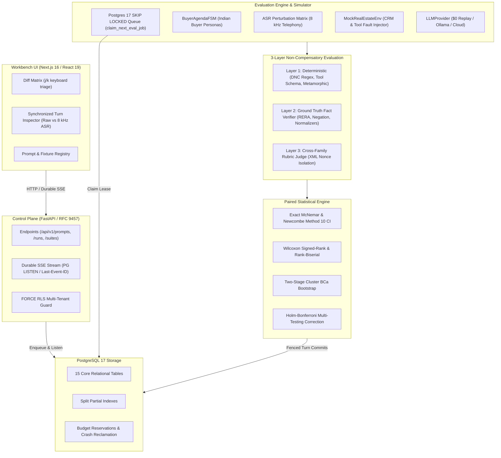

# PropEval — Hinglish Real-Estate Voice Agent Evaluation & Prompt Regression Workbench

[](https://www.python.org/)
[](https://www.postgresql.org/)
[](https://nextjs.org/)
[](backend/tests/)
[](#local-0-build)
[](backend/tests/red_team/)

PropEval is an enterprise-grade evaluation and regression workbench purpose-built for **telephony-based Hinglish real-estate voice AI agents**. It eliminates subjective LLM-as-a-judge scoring, replaces naive averages with paired statistical confidence intervals, and halts deployments on hard compliance regressions.

---

## Why PropEval?

In Indian real-estate voice agents, general-purpose LLM evaluation frameworks (e.g., DeepEval, Ragas, Promptfoo) fail due to three core realities:

1. **Compensatory Scoring Conceals Fatal Flaws:** An agent scoring 92% overall might have violated TRAI Do-Not-Call (DNC) regulations on turn 4, or falsely confirmed a WhatsApp brochure dispatch after an HTTP 503 CRM failure. In real estate, **one compliance violation blocks the prompt**.
2. **Indian Telephony Acoustic Reality:** Buyer speech over 8 kHz phone audio features code-switching (*"1.2 cr chalega, but possession 2026 tak chahiye"*), phoneme confusion (*"crore"* misheard as *"core"*, *"lakh"* as *"lack"*), and Devanagari numerals (`१.५ करोड़`).
3. **Paired Statistical Rigor:** A prompt change cannot be declared "better" based on point-estimate pass rates. PropEval enforces **Exact McNemar tests with Newcombe Method 10 confidence intervals** and **Two-Stage Cluster BCa Bootstrapping** with explicit `SMOKE_TEST_UNDERPOWERED` warnings when $N < 50$.

---

## Architecture



---

## Core Capabilities

### 1. 3-Layer Non-Compensatory Evaluation
- **Layer 1: Deterministic Compliance:**
  - TRAI DNC immediate exit enforcement.
  - Invented action detection (blocking verbal confirmation of side-effects when backend tools failed or were never invoked).
  - Strict JSON schema validation for tool calls.
  - Metamorphic currency invariance testing (`1.2 cr` $\equiv$ `120 lakh` $\equiv$ `₹ 1,20,00,000`).
- **Layer 2: Fact Verification:**
  - Property ground truth checking against versioned fixtures (e.g. Lodha Wakad, DLF Gurugram).
  - Negation-window extraction (verifying the agent did not flip negative constraints into positive claims).
  - Comprehensive Indian real-estate normalizers: Crore, Lakh, Thousand, BHK (`2.5 BHK`, `3 BHK`), sq ft / sq yd, and Devanagari numerals (`१२ लाख`).
- **Layer 3: Cross-Family Rubric Judge:**
  - Enforces model family diversity (e.g., Anthropic Claude evaluating OpenAI GPT outputs, never same-family self-grading).
  - Hardened with **cryptographic XML nonce boundaries** (`<transcript_{nonce}>`) to neutralize OWASP LLM01 prompt injection attacks.
  - Position-swap debiasing for pairwise preference judgments.

### 2. Paired Statistical Gating
- **$K=1$ Pass/Fail:** Exact McNemar test with Newcombe Method 10 95% Confidence Interval.
- **$K > 1$ Graded Scores:** Wilcoxon Signed-Rank test with rank-biserial correlation and Two-Stage Cluster BCa Bootstrapping (clustering by buyer scenario to account for intra-scenario correlation).
- **Multiple Testing:** Holm-Bonferroni family-wise error rate control across metric families.
- **Sample Power Protection:** Explicitly outputs `SMOKE_TEST_UNDERPOWERED (N = 20 < 50)` on small runs.

### 3. High-Throughput PostgreSQL 17 Storage
- `SECURITY DEFINER claim_next_eval_job()` function using `SELECT ... FOR UPDATE SKIP LOCKED` with per-tenant fairness caps.
- Split partial indexes on hot execution paths (`idx_eval_jobs_queued`, `idx_eval_jobs_expired_lease`).
- Multi-tenant isolation enforced via `FORCE ROW LEVEL SECURITY` with `NULLIF(current_setting('app.current_tenant_id', true), '')`.
- Transient budget reservations with automated background reclamation of abandoned reservations on worker crash.

### 4. Anti-Slop Next.js 16 Workbench
- Neutral canvas (`#FAFAFA`), 1px borders (`#E5E7EB`), tabular `IBM Plex Mono` metrics. Zero purple gradients, zero radial score dials.
- Real-time durable SSE streaming with `Last-Event-ID` resume support.
- Synchronized split-pane turn inspector with **Raw Intent vs. 8 kHz ASR perturbation** toggle.
- Full keyboard navigation (`j`/`k` scenario cycling).

---

## Local $0 Build & Quickstart

PropEval runs 100% locally with zero cloud API dependencies.

### Prerequisites
- Python 3.12+ with `uv`
- Node.js 20+ with `pnpm`
- Docker & Docker Compose

### 1. Start Infrastructure
```bash
docker compose up -d
```
Starts PostgreSQL 17 on `localhost:5433` and Jaeger OpenTelemetry on `localhost:16686`.

### 2. Install Dependencies
```bash
# Backend dependencies
uv sync

# Frontend dependencies
cd web && pnpm install && cd ..
```

### 3. Run the CLI Regression Gate
```bash
uv run python -m backend.cli.main run \
  --baseline fixtures/prompt_baseline_v1.yaml \
  --candidate fixtures/prompt_candidate_regressed.yaml \
  --suite suites/hinglish_smoke_20.yaml \
  --fixture fixtures/lodha_wakad_2026_11.yaml \
  --gate
```

### 4. Start the Application & UI
```bash
# Terminal 1: FastAPI Control Plane
uv run uvicorn backend.app.main:app --host 0.0.0.0 --port 8001

# Terminal 2: Next.js 16 Workbench
cd web && pnpm dev
```
Open **`http://localhost:3000`** in your browser.

---

## Test & Verification Proof

PropEval includes 79 automated tests covering unit logic, property fuzzing, meta-evaluations, end-to-end browser workflows, and red-team security attacks:

```bash
uv run pytest -v
```

```text
============================== test session starts ===============================
platform darwin -- Python 3.12.13, pytest-9.2.0, pluggy-1.7.0
rootdir: /Users/nitrousoxide/Code/hugo
collected 79 items

backend/tests/red_team/test_vector1_prompt_injection.py (5 tests) ....... PASSED
backend/tests/red_team/test_vector2_rls_auth_escape.py (4 tests) ......... PASSED
backend/tests/red_team/test_vector3_ssrf_slowloris.py (4 tests) .......... PASSED
backend/tests/red_team/test_vector4_dpdp_pii_fuzzing.py (4 tests) ........ PASSED
backend/tests/red_team/test_vector5_concurrency_budget_crash.py (4 tests)  PASSED
backend/tests/red_team/test_vector6_stats_hinglish_fuzzing.py (6 tests) .. PASSED
backend/tests/test_api_endpoints.py (2 tests) ............................ PASSED
backend/tests/test_evaluation_layers.py (9 tests) ........................ PASSED
backend/tests/test_fsm_simulator.py (11 tests) ........................... PASSED
backend/tests/test_mutation_meta_eval.py (5 tests) ....................... PASSED
backend/tests/test_normalizers.py (5 tests) .............................. PASSED
backend/tests/test_paired_stats.py (11 tests) ............................ PASSED
backend/tests/test_partial_indexes.py (1 test) ........................... PASSED
backend/tests/test_playwright_workbench.py (1 test) ....................... PASSED
backend/tests/test_security_pii.py (3 tests) ............................. PASSED
backend/tests/test_sigkill_reclamation.py (1 test) ....................... PASSED

=============================== 79 passed in 6.87s ===============================
```

### 5-Mutant Meta-Evaluation (`test_mutation_meta_eval.py`)
PropEval's own evaluation pipeline was tested against 5 deliberate prompt mutants to verify 100% regression capture:
1. **Mutant 1 (Dropped DNC):** Candidate agent continues pitching after buyer says *"Call mat karna"*. **Result: CAUGHT (Layer 1 DNC Hard Gate)**.
2. **Mutant 2 (Stale Possession):** Candidate promises December 2025 instead of RERA date March 2026. **Result: CAUGHT (Layer 2 Ground Truth)**.
3. **Mutant 3 (Broken Currency):** Candidate misinterprets *"1.2 core"* as 1.2 Lakh. **Result: CAUGHT (Layer 2 Normalizer)**.
4. **Mutant 4 (Invented Action):** Candidate claims WhatsApp brochure sent after CRM returned HTTP 503. **Result: CAUGHT (Layer 1 Invented Actions)**.
5. **Mutant 5 (Malformed Schema):** Candidate passes string instead of integer for budget. **Result: CAUGHT (Layer 1 Tool Schema)**.

---

## Visual Verification (Playwright)

Automated Playwright browser tests verify the Next.js UI across desktop (`1440x900`) and tablet (`768x1024`) with 0 console errors and 0 hydration warnings:

| Screen | Desktop (1440x900) | Tablet (768x1024) |
|---|---|---|
| **Workbench** | `web/screenshots/workbench_1440x900.png` | `web/screenshots/workbench_768x1024.png` |
| **Turn Inspector** | `web/screenshots/scenario_inspector_1440x900.png` | `web/screenshots/scenario_inspector_768x1024.png` |
| **Registry** | `web/screenshots/registry_1440x900.png` | `web/screenshots/registry_768x1024.png` |

---

## Interview & Architecture Package

The complete architectural research and interview preparation guides have been preserved in `~/Desktop/propeval-interview-kit/`:
- `01_PITCH_AND_3MIN_DEMO_SCRIPT.md`: 60-second founder pitch, 3-minute live demo script, and CTO Q&A.
- `02_BACKEND_DB_CONCURRENCY_GUIDE.md`: Deep dive into PostgreSQL 17 `SKIP LOCKED`, RLS, and partial indexing.
- `03_VOICE_SIM_AND_STATS_GUIDE.md`: Voice FSM simulation, 8 kHz ASR confusion matrix, and paired stats formulas.
- `04_FRONTEND_UX_CRAFT_GUIDE.md`: Anti-slop UI design system and Playwright visual proof loop.
- `05_RED_TEAM_WAR_STORIES.md`: Exploit breakdowns, initial bugs, and permanent security hardening across 6 vectors.
- `research-docs/`: The full 18-part architecture and ADR specification of record.

---

## License
PropEval is developed under the Apache 2.0 License.
