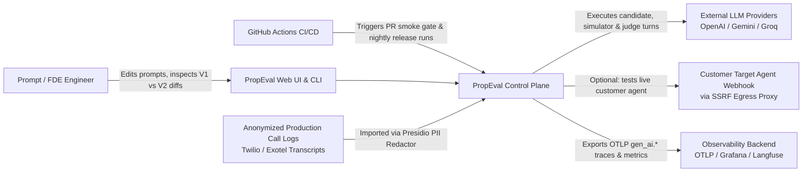
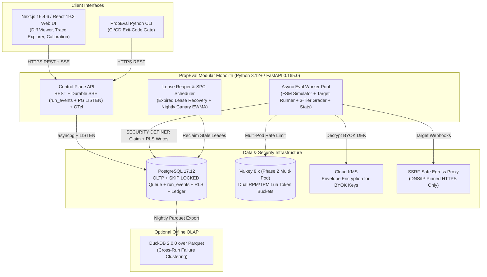
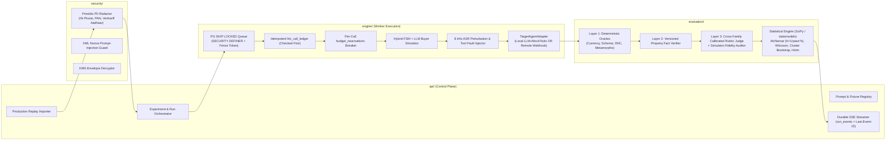
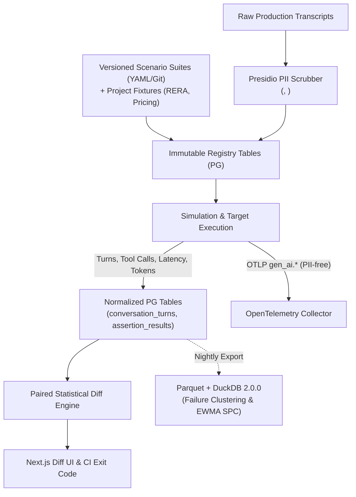
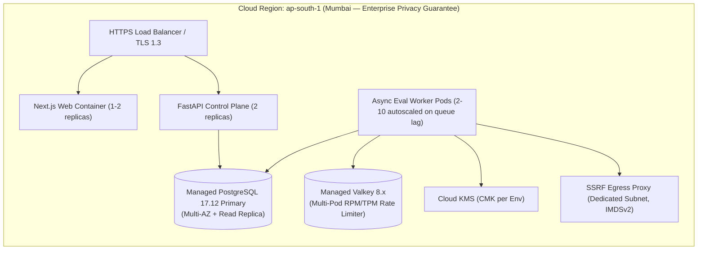

# 02 — High-Level Design (HLD)

## 1. System Overview & Architectural Style

PropEval is designed as a **Modular Monolith with a PostgreSQL Transactional Job Queue (`FOR UPDATE SKIP LOCKED` + Lease/Fence Tokens) and Durable Server-Sent Events (SSE) Streaming**, accompanied by a thin CLI client for CI/CD regression gating.

* **Why this style (summary of [`ADR-001`](./adr/ADR-001-modular-monolith-vs-microservices-vs-cli.md)):** PropEval's workload is I/O-bound, high-latency (2–45 s per multi-turn LLM interaction), bursty (CI merges + nightly batches), and cost-sensitive. A modular monolith backed by PostgreSQL `17.12` provides ACID transactional guarantees between run creation, per-call budget reservations, job enqueueing, durable SSE `run_events`, and transcript persistence—eliminating distributed two-phase commits and Kafka/Temporal operational overhead while maintaining strict internal module boundaries.

---

## 2. System Context Diagram (C4 Level 1)



---

## 3. Container Diagram (C4 Level 2)



---

## 4. Component Diagram (C4 Level 3 — Inside the Modular Monolith)



---

## 5. End-to-End Experiment Lifecycle Sequence Diagram

```mermaid
sequenceDiagram
    actor Eng as Engineer / CI
    participant API as FastAPI Control Plane
    participant PG as PostgreSQL 17.12 (Queue + Ledger + run_events)
    participant W as Async Eval Worker
    participant LLM as Independent LLM Providers (Sim / Target / Judge)

    Eng->>API: POST /api/v1/runs (v1_id, v2_id, suite_id, trials_k=3, max_budget_usd=4.50)
    API->>PG: BEGIN; INSERT eval_runs + 2*N*K eval_jobs (QUEUED); COMMIT
    API-->>Eng: 202 Accepted (run_id, stream_url)
    Eng->>API: GET /api/v1/runs/{run_id}/stream (SSE + Last-Event-ID)

    loop For each claimed job (paired V1 & V2 scenarios)
        W->>PG: SELECT * FROM claim_next_eval_job(worker_id, 60) -> fence_token++, releases stale reservations
        W->>PG: SET LOCAL app.current_tenant_id = job.tenant_id
        loop Turns 1..max_turns (while FSM != TERMINAL)
            W->>W: FSM decides next buyer agenda directive
            W->>PG: Check llm_call_ledger FIRST -> if miss, reserve budget_reservations
            W->>LLM: Simulator LLM renders Hinglish -> apply 8 kHz ASR perturbation
            W->>LLM: Target Agent responds + executes replayable MockRealEstateEnv tools
            W->>PG: Fenced persist_turn(fence_token) + settle budget_reservations
        end
        W->>LLM: Simulator Auditor & Cross-Family Judge (also via ledger + budget_reservations)
        W->>PG: Fenced Commit + INSERT run_events('job.completed') + NOTIFY
        API-->>Eng: SSE event: job.completed
    end

    W->>PG: Atomic CAS (RUNNING -> COMPUTING_STATS) -> compute paired stats
    W->>PG: UPDATE eval_runs + INSERT run_events('run.completed') + NOTIFY
    API-->>Eng: SSE event: run.completed (diff_summary)
```

---

## 6. Data Flow Diagram



---

## 7. Prompt Version, Dataset & Evaluation Lifecycles

1. **Prompt Version Lifecycle (`prompt_versions.status`):** `DRAFT` $\to$ `REGISTERED` $\to$ `CANDIDATE_EVALUATING` $\to$ `GATED_PASS | GATED_REGRESSED` $\to$ `PRODUCTION_BASELINE` $\to$ `ARCHIVED`.
2. **Dataset Version Lifecycle (`scenario_suites.suite_tier`):** Immutable Git-versioned YAML suites stratified into `smoke_pr` ($N=20$), `release_gate` ($N=50\text{–}100$), `metamorphic`, and `canary_spc`, plus `calibration_anchors` for judge calibration.
3. **Evaluation Run Lifecycle (`eval_runs.status`):** `QUEUED` $\to$ `RUNNING` $\to$ `COMPUTING_STATS` $\to$ `PASSED | REGRESSED | INCONCLUSIVE_UNDERPOWERED | BUDGET_EXCEEDED | EARLY_ABORTED_HARM | FAILED`.

---

## 8. Deployment Diagram & Scaling Strategy


