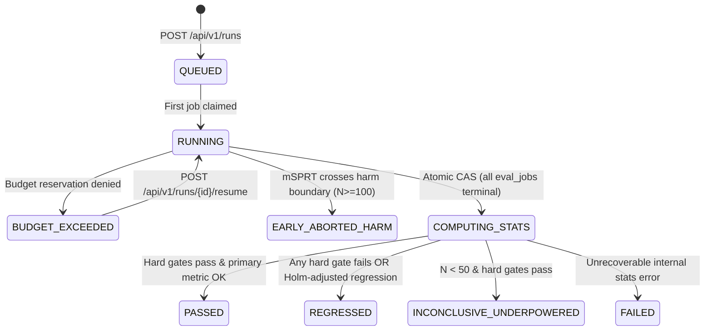
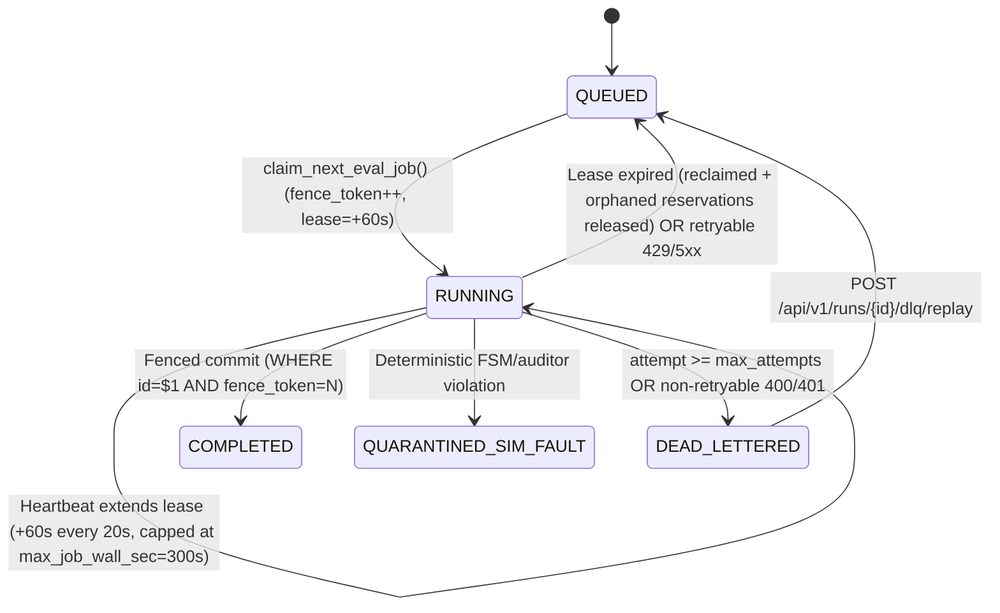

# 03 — Low-Level Design (LLD)

This document is an implementation-ready engineering blueprint for PropEval. *(Per scope constraints, all code blocks below are design specifications, interfaces, SQL DDL excerpts, and pseudocode—no application code has been implemented or executed.)*

---

## 1. Repository & Module Directory Structure

Strict module boundaries inside the Modular Monolith ensure `engine/`, `evaluation/`, and `stats/` have zero FastAPI imports (~1,800–2,500 LOC total across core modules, excluding tests and UI):

```text
propeval/
├── backend/
│   ├── app/
│   │   ├── main.py                     # FastAPI app factory, OTel init, lifespan hooks
│   │   ├── config.py                   # Pydantic Settings (env, KMS, rate limits)
│   │   ├── api/                        # HTTP Control Plane (thin controllers only)
│   │   │   ├── deps.py                 # Auth, SET LOCAL tenant RLS, idempotency middleware
│   │   │   ├── prompts.py              # /api/v1/prompts
│   │   │   ├── fixtures.py             # /api/v1/fixtures
│   │   │   ├── suites.py               # /api/v1/suites & /api/v1/replay/import
│   │   │   ├── runs.py                 # /api/v1/runs, /diff, /stream (SSE), /resume, /dlq/replay
│   │   │   ├── calibration.py          # /api/v1/calibration/evaluate
│   │   │   └── tenants.py              # DELETE /api/v1/tenants/{id} (DPDP erasure)
│   │   ├── domain/                     # Pure Pydantic v2 models & RFC 9457 error hierarchy
│   │   ├── storage/                    # PostgreSQL persistence + RLS + Queue + run_events
│   │   │   ├── db.py                   # asyncpg pool, SET LOCAL app.current_tenant_id
│   │   │   ├── queue.py                # SECURITY DEFINER claim, heartbeat, fenced commit, DLQ
│   │   │   ├── budget.py               # Per-call budget_reservations + settlement
│   │   │   ├── ledger.py               # Idempotent llm_call_ledger lookup/write
│   │   │   └── events.py               # PG run_events + LISTEN/NOTIFY (Last-Event-ID replay)
│   │   ├── providers/                  # Thin LLM & Target Agent abstractions
│   │   │   ├── base.py                 # LLMProvider Protocol, TargetAgentAdapter Protocol
│   │   │   ├── openai_adapter.py       # openai>=3.54.0 async client
│   │   │   ├── gemini_adapter.py       # google-genai>=3.2.0 async client
│   │   │   ├── groq_adapter.py         # groq>=1.7.0 async client
│   │   │   ├── rate_limiter.py         # Valkey Lua dual RPM+TPM token bucket (or in-proc MVP)
│   │   │   └── circuit_breaker.py      # Closed/Open/Half-Open state machine
│   │   ├── engine/                     # Multi-turn simulation & fault injection
│   │   │   ├── fsm_simulator.py        # Deterministic agenda FSM + LLM surface realizer
│   │   │   ├── perturbations.py        # Domain 8 kHz Indian ASR confusion + barge-in truncator
│   │   │   ├── mock_tools.py           # Stateful MockRealEstateEnv (replayable on resume)
│   │   │   ├── target_webhook.py       # DNS-pinned SSRF-safe RemoteWebhookAgentAdapter
│   │   │   └── worker.py               # Main async worker loop + wall-clock deadline + heartbeat
│   │   ├── evaluation/                 # Non-compensatory 3-tier grading pipeline
│   │   │   ├── normalizers.py          # Indian currency (lakh/crore/Hinglish), BHK, RERA
│   │   │   ├── deterministic.py        # Layer 1: Schema, DNC, metamorphic, tool-outcome checks
│   │   │   ├── fact_verifier.py        # Layer 2: Structured numeric/date/RERA entailment
│   │   │   ├── rubric_judge.py         # Layer 3: Cross-family binary judge + position swap
│   │   │   ├── simulator_auditor.py    # Deterministic FSM check + advisory drift flag
│   │   │   └── calibration.py          # Cohen's kappa, Fail-P/R, clamped Rogan-Gladen, PPI++
│   │   ├── stats/                      # 100% deterministic SciPy / statsmodels analytics
│   │   │   ├── paired_tests.py         # Exact McNemar (K=1/pass^k), Newcombe CI, Wilcoxon, t-test
│   │   │   ├── bootstrap.py            # Two-stage cluster/hierarchical BCa & percentile bootstrap
│   │   │   ├── multiplicity.py         # Holm-Bonferroni, BH-FDR, pass^k, power warnings
│   │   │   └── monitoring.py           # mSPRT early-abort, EWMA & p-chart SPC
│   │   └── security/                   # Presidio PII redaction, XML nonce guard, KMS envelope
│   ├── cli/                            # Thin CI/CD CLI calling Control Plane REST API
│   └── tests/                          # pytest + Hypothesis property/mutation tests
├── web/                                # Next.js 16.4.6 / React 19.3 Diff & Trace Explorer
└── docs/                               # Architecture, research, ADRs
```

---

## 2. Core Internal Interfaces

```python
from typing import Protocol, Any, Literal
from pydantic import BaseModel

class LLMMessage(BaseModel):
    role: Literal["system", "user", "assistant", "tool"]
    content: str
    tool_call_id: str | None = None

class LLMResponse(BaseModel):
    text: str
    tool_calls: list[dict[str, Any]]
    input_tokens: int
    output_tokens: int
    ttft_ms: int
    total_ms: int
    cost_usd: float
    provider: str
    model_id: str

class LLMProvider(Protocol):
    async def complete(
        self, *, messages: list[LLMMessage], model_id: str, temperature: float,
        max_tokens: int, tools: list[dict[str, Any]] | None = None,
        response_schema: type[BaseModel] | None = None, timeout_sec: float = 45.0,
    ) -> LLMResponse: ...

class TargetAgentAdapter(Protocol):
    async def respond(
        self, *, conversation_id: str, prompt_version_id: str, history: list[LLMMessage],
        user_utterance: str, project_fixture: dict[str, Any], turn_index: int,
    ) -> LLMResponse: ...
```

---

## 3. State Machines

### 3.1 Evaluation Run State Machine (`eval_runs.status`)


### 3.2 Evaluation Job State Machine (`eval_jobs.status`)


---

## 4. Core Algorithm Specifications & Pseudocode

### 4.1 Worker Lifecycle: Ledger-First Budget, Fenced Turns & Atomic Run Finalization
Fixes all four concurrency/cost hazards: (1) checks `llm_call_ledger` *before* reserving budget; (2) routes *all* LLM calls (simulator, target, auditor, judge) through `call_with_ledger_and_budget`; (3) fences `persist_turn` with `fence_token`; and (4) uses atomic CAS on `eval_runs` finalization:

```python
async def call_with_ledger_and_budget(
    job: EvalJob, fence_token: int, idempotency_key: str, est_cost_usd: float, call_fn
) -> LLMResponse:
    # Step 1: Check completed ledger FIRST — resumed turns cost $0 and skip reservation
    cached = await ledger.get_completed(job.tenant_id, idempotency_key)
    if cached:
        return cached

    # Step 2: Create per-call budget_reservation row (auto-released if worker crashes & lease expires)
    res_id = await budget.reserve_per_call(
        tenant_id=job.tenant_id, run_id=job.run_id, job_id=job.id,
        fence_token=fence_token, est_cost_usd=est_cost_usd
    )
    try:
        resp = await asyncio.wait_for(call_fn(), timeout=45.0)  # Hard wall-clock deadline
        await ledger.record_completed(job.tenant_id, idempotency_key, resp)
        await budget.settle(res_id, actual_cost_usd=resp.cost_usd)
        return resp
    except Exception:
        await budget.release(res_id)
        raise

async def maybe_finalize_run(tenant_id: UUID, run_id: UUID) -> None:
    if await storage.has_incomplete_jobs(tenant_id, run_id):
        return
    # Atomic CAS ensures exactly ONE worker computes stats & emits run.completed
    claimed = await storage.cas_run_status(
        tenant_id, run_id, expected="RUNNING", new_status="COMPUTING_STATS"
    )
    if not claimed:
        return
    stats = await stats_engine.compute_paired_diff(tenant_id, run_id)
    await storage.finalize_run_and_emit_event(tenant_id, run_id, stats)
```

### 4.2 Hybrid FSM + LLM Buyer Simulator (with Stateful Resume Replay & Zero-Embedding Stall Guard)
```python
async def run_hybrid_simulation(job: EvalJob, prior_turns: list[Turn], fence_token: int) -> SimResult:
    fsm = BuyerAgendaFSM.from_yaml(job.scenario.fsm_spec, resume_turns=prior_turns)
    mock_env = MockRealEstateEnv(job.project_fixture, fault_rules=job.scenario.fault_rules)
    # CRITICAL: Replay prior tool_calls deterministically so resumed jobs match exact mock DB state
    for pt in prior_turns:
        mock_env.replay_tool_calls(pt.tool_calls, turn_index=pt.turn_index)

    history = to_llm_messages(prior_turns)
    for turn_idx in range(len(prior_turns), job.scenario.max_turns):
        if fsm.is_terminal():
            break
        directive = fsm.step(last_agent_turn=history[-1] if history else None)
        if directive.action == "HANG_UP":
            break

        sim_key = sha256(f"{job.tenant_id}|{job.run_id}|{job.id}|{turn_idx}|sim|{job.sim_model}")
        buyer_raw = await call_with_ledger_and_budget(
            job, fence_token, sim_key, est_cost_usd=0.002,
            call_fn=lambda: sim_provider.complete(...)
        )
        buyer_utterance = perturbations.apply(buyer_raw.text, job.scenario.asr_noise_profile, seed=job.seed + turn_idx)

        tgt_key = sha256(f"{job.tenant_id}|{job.run_id}|{job.id}|{turn_idx}|tgt|{job.prompt_hash}")
        agent_resp = await call_with_ledger_and_budget(
            job, fence_token, tgt_key, est_cost_usd=0.005,
            call_fn=lambda: target_adapter.respond(...)
        )
        tool_outcomes = mock_env.execute_all(agent_resp.tool_calls, turn_index=turn_idx)

        # Zero-embedding deterministic stall guard (normalized token Jaccard > 0.85 across 3 turns)
        if detect_ngram_stall(history, agent_resp.text, window=3, jaccard_threshold=0.85):
            fsm.force_terminate("STALL_LOOP_ABORT")

        # Fenced turn persistence: rejects zombie worker writes
        await storage.fenced_persist_turn(
            job.tenant_id, job.id, fence_token, turn_idx,
            fsm.state, buyer_raw.text, buyer_utterance, agent_resp, tool_outcomes
        )
        history.extend(format_turn_messages(buyer_utterance, agent_resp, tool_outcomes))

    return SimResult(history=history, mock_db_state=mock_env.snapshot_hash(), fsm_trace=fsm.trace)
```

### 4.3 Domain 8 kHz ASR Perturbation & Layer-2 Fact Entailment Spec
* **ASR Perturbation Matrix (`engine/perturbations.py`):** Deterministic seeded pipeline applying Indian PSTN homophone swaps (`"crore"` $\to$ `"core"`, `"lakh"` $\to$ `"luck"`, `"BHK"` $\to$ `"B K"`, `"Wakad"` $\to$ `"walked"`), Hindi postposition drops (`"mein"`, `"ka"`, `"tak"`), and optional barge-in tail truncation (cutting the last 20–40% of tokens on designated interruption turns).
* **Layer-2 Property Fact Entailment (`evaluation/fact_verifier.py`):** Hybrid two-step verifier: (1) deterministic extractor pulls explicit currency amounts (via `normalizers.py`), sq.ft carpet areas, RERA IDs (`P\d{11}` / state regexes), and ISO/quarter dates while checking a 4-token local negation window (`"nahi"`, `"not"`, `"except"`) so corrections like *"1.2 cr nahi, 1.5 cr hai"* extract the affirmed claim (`1.5 cr`); (2) compares affirmed numeric claims against active `project_fixtures.facts_json` with configurable rounding tolerance (default ±1% for EMI/floor-rise estimates, 0% for RERA ID and carpet area). Ambiguous colloquial timelines (*"agle saal Diwali tak"*) are routed to a cross-family binary entailment check rather than false-failing regex.
* **Layer-1 Invented-Action Verifier (`evaluation/deterministic.py`):** Separates deterministic **tool-call outcome checks** (did `book_site_visit` return `200`?) from **confirmation-intent detection** (regex filters out interrogative patterns like *"kya main book kar doon?"* / `"?"`, and flags ambiguous Hinglish confirmations for a lightweight binary cross-family entailment check when tool status != `200`).

---

## 5. Statistical & Calibration Formulas (`stats/` & `evaluation/calibration.py`)

* **Binary Outcomes ($K = 1$, or Binary `pass^k` per scenario):**
  * Exact McNemar: `scipy.stats.binomtest(min(b, c), b + c, p=0.5).pvalue`.
  * **Newcombe Paired Wilson 95% CI (Method 10):** Compute marginal Wilson intervals $[l_1, u_1], [l_2, u_2]$ for $\hat{p}_1, \hat{p}_2$, empirical correlation $\hat{\phi} = \frac{\max(|ad - bc| - N/2, 0) \cdot \operatorname{sign}(ad - bc)}{\sqrt{(a+b)(c+d)(a+c)(b+d)}}$ (0 if denominator is 0), and half-widths $\delta_{\text{lower}} = \sqrt{(\hat{p}_1 - l_1)^2 - 2\hat{\phi}(\hat{p}_1 - l_1)(u_2 - \hat{p}_2) + (u_2 - \hat{p}_2)^2}$, $\delta_{\text{upper}} = \sqrt{(u_1 - \hat{p}_1)^2 - 2\hat{\phi}(u_1 - \hat{p}_1)(\hat{p}_2 - l_2) + (\hat{p}_2 - l_2)^2}$, yielding $[\hat{\Delta p} - \delta_{\text{lower}}, \hat{\Delta p} + \delta_{\text{upper}}]$ clamped to $[-1, 1]$.
* **Multi-Trial Continuous Pass Rates ($K > 1$) & Skewed Metrics:** Paired Wilcoxon signed-rank (`zero_method='pratt'`) + Two-Stage Cluster/Hierarchical BCa Bootstrap (falling back to `percentile` if BCa returns `NaN`). **McNemar/Newcombe are NEVER run on pooled $N \times K$ trials.**
* **Quarantined Pair Exclusion:** If either V1 or V2 on scenario $i$ is `QUARANTINED_SIM_FAULT`, **both** V1 and V2 for scenario $i$ are excluded from paired statistical tests, and `effective_paired_scenarios` is reported explicitly.
* **Clamped Rogan–Gladen:** If $\text{TPR} + \text{TNR} \le 1.05$ or $\kappa < 0.70$, mark `UNCALIBRATED_ADVISORY_ONLY`; otherwise compute $\hat{\pi}_{\text{RG}} = \operatorname{clip}\!\left(\frac{\hat{p} + \text{TNR} - 1}{\text{TPR} + \text{TNR} - 1},\; 0,\; 1\right)$ with bootstrap uncertainty propagation over the golden calibration set.
