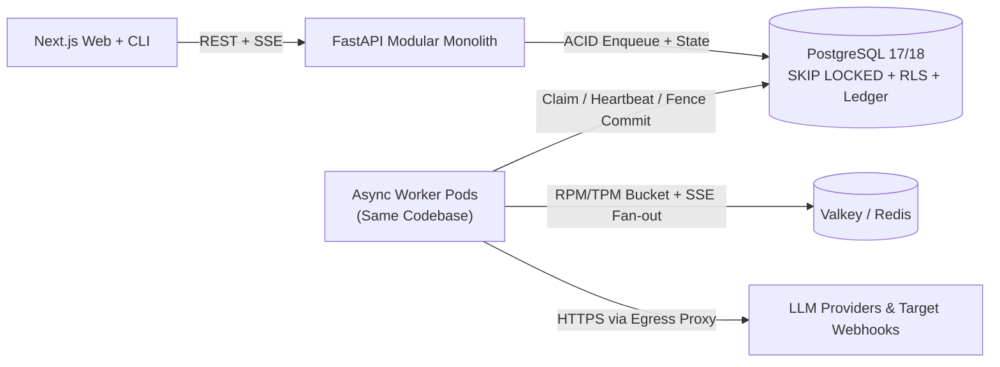
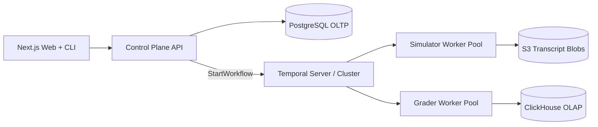
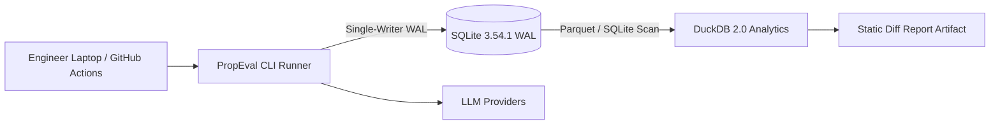

# 10 — Architecture Design Competition & Trade-Offs

Per Section 8 of the architectural mandate, we independently designed and competed **three substantially different architectures** rather than assuming either microservices or a modular monolith is inherently superior.

---

## 1. The Three Competing Architectural Options

### Option A: Modular Monolith + PostgreSQL `FOR UPDATE SKIP LOCKED` Queue + SSE
A single deployable Python/FastAPI codebase cleanly partitioned into `api/`, `engine/`, `evaluation/`, `stats/`, and `security/`. PostgreSQL handles both OLTP state and transactional job queuing (`FOR UPDATE SKIP LOCKED` + lease heartbeats + fencing tokens); Valkey provides RPM/TPM rate limiting and SSE Pub/Sub fan-out; a thin CLI calls the same REST API for CI/CD gating.

### Option B: Event-Driven Microservices (Temporal + Separate Worker Pools + PG + ClickHouse/S3)
Control plane (FastAPI + PostgreSQL) dispatches durable multi-turn evaluation workflows to [Temporal Server (`v1.32.2`)](https://docs.temporal.io/evaluate/understanding-temporal), with independently autoscaled Simulator and Grader worker pools. Full transcripts land in S3; per-turn metrics and assertion results stream into [ClickHouse MergeTree](https://clickhouse.com/docs/reference/engines/table-engines/mergetree-family/mergetree) for sub-second analytical aggregations across tens of millions of rows.

### Option C: Lightweight CLI-First Local / Serverless Runner (SQLite WAL + DuckDB + GitHub Actions)
A local Python/Promptfoo CLI executing directly on engineer laptops or GitHub Actions runners. State persists in [SQLite `3.54.1` WAL](https://www.sqlite.org/wal.html), cross-run slicing uses [DuckDB `2.0.0`](https://duckdb.org/docs/2.0/sql/dialect/overview), and HTML/JSON diff reports publish as static CI artifacts with zero persistent servers.

---

## 2. Sixteen-Dimension Architectural Comparison

| Dimension | Option A: Modular Monolith + PG Queue | Option B: Microservices (Temporal + ClickHouse) | Option C: CLI-First (SQLite + DuckDB) |
| :--- | :--- | :--- | :--- |
| **1. Boundaries** | Strict Python package modules (`api`, `engine`, `evaluation`, `stats`) | Separate network-isolated services + workflow engine | Single-process CLI binary |
| **2. Data Flow** | Single ACID PG store; optional nightly Parquet $\to$ DuckDB | Dual-write/CDC across PG, S3, and ClickHouse | Local file writes $\to$ CI artifacts |
| **3. Execution Model** | `asyncio` worker coroutines pulling from `eval_jobs` | Temporal durable Event History + separate Activity pools | In-process `asyncio.Semaphore` batch loop |
| **4. Database & Storage** | PostgreSQL 17/18 + Valkey (minimal ops) | PostgreSQL + ClickHouse + S3 + Temporal DB (4 stores) | SQLite WAL + DuckDB (0 servers) |
| **5. Background Processing** | `FOR UPDATE SKIP LOCKED` (~500–2,000 jobs/sec) | Millions of durable workflows, multi-day HITL pauses | Bounded by single CI runner lifetime (6h max) |
| **6. Provider Integration** | Shared Valkey dual RPM/TPM buckets across all pods | Isolated per-pool rate limiters | Per-process only (parallel CI runs collide on 429s) |
| **7. Failure Handling** | Lease reaper + `fence_token` + `llm_call_ledger` | Automatic Temporal replay from Event History | Process crash kills run; manual `--resume` required |
| **8. Concurrency** | 1–10 pods, 200+ async coroutines, row-level locks | Virtually unbounded horizontal scaling | Single-writer SQLite lock (`SQLITE_BUSY` risk) |
| **9. Security & Tenancy** | PG `FORCE ROW LEVEL SECURITY` + KMS + SSRF proxy | Full service mesh + mTLS + per-service IAM | Local env vars only; no multi-tenant SaaS boundary |
| **10. Observability** | Single OTel trace tree (`eval.run` $\to$ `gen_ai.*`) | Distributed cross-service OTel + Temporal Web UI | Local JSONL logs; no centralized longitudinal SPC |
| **11. Deployment** | 1 `docker-compose.yml` / 2–4 cloud containers | Kubernetes / Managed Temporal + ClickHouse + PG | `pip install` + GitHub Actions YAML |
| **12. Scaling Ceiling** | ~500 job state transitions/sec; ~50M assertion rows | 10,000+ transitions/sec; billions of rows | ~500 conversations/hour per runner |
| **13. Infra Cost (Est.)** | ~$100–$350/mo (1 managed PG + Valkey + app pods) | ~$1,200–$4,000+/mo (Temporal + ClickHouse + PG + NAT) | $0–$50/mo (CI minutes only) |
| **14. Maintenance Burden** | Low (1 repo, 1 DB schema, watch PG autovacuum) | High (4 data stores, Temporal determinism rules) | Very low, but zero shared UI for non-eng QA |
| **15. Live UX** | Real-time SSE (`Last-Event-ID`) browser diffing | Real-time SSE via gateway + Temporal query API | Static post-hoc HTML artifact only |
| **16. Solo/Small-Team Fit** | **Optimal** (buildable in 3–4 weeks, production-credible) | Over-engineered (months of infra before first eval) | Fast to start, fails non-eng QA & SaaS needs |

---

## 3. Weighted Decision Matrix

| Criterion (Weight) | Option A (Monolith + PG) | Option B (Temporal + CH) | Option C (CLI + SQLite) |
| :--- | :---: | :---: | :---: |
| Fits PropEval MVP & Huvo Team Scale (25) | **24** | 11 | 15 |
| Reliability, Concurrency & Cost Safety (20) | **18** | 20 | 9 |
| Shared Web UX + CI/CD Dual Workflow (15) | **15** | 15 | 6 |
| Operational Simplicity & Solo Buildability (20) | **18** | 6 | 19 |
| Security, DPDP Compliance & Tenancy (10) | **9** | 10 | 4 |
| Clear Evolution Path Without Rewrite (10) | **9** | 9 | 5 |
| **Total Score (100)** | **93** | **71** | **58** |

---

## 4. Selected Architecture & Explicit Revisit Triggers

**Winner: Option A — Modular Monolith + PostgreSQL `SKIP LOCKED` Queue + SSE + Thin CLI.**  
It captures 95% of Option B's reliability (ACID job enqueue + state commits, lease/fencing crash recovery, idempotent LLM ledger, atomic USD budget cap, multi-tenant RLS) at **<10% of the infrastructure cost and operational complexity**, while giving Prompt Engineers and founders a live web diffing UI that Option C cannot provide.

**Exact Quantitative Conditions to Revisit & Migrate:**
* **Migrate Option A $\to$ Option B (Temporal)** if: (1) sustained queue transitions exceed **500/sec** causing PG WAL/autovacuum lag; (2) workflows require **multi-hour/multi-day human-in-the-loop grading pauses**; or (3) Simulator webhook I/O and Grader LLM pools require isolated scaling blast radii.
* **Add ClickHouse alongside PG** if cross-run failure clustering queries exceed **50M assertion rows** and degrade OLTP read replicas even after DuckDB/Parquet offloading.
* **Offer Option C as a Local Mode** (`propeval local-run --sqlite`) only as a lightweight developer-laptop preview sharing the exact same `engine/` and `evaluation/` Python packages.
