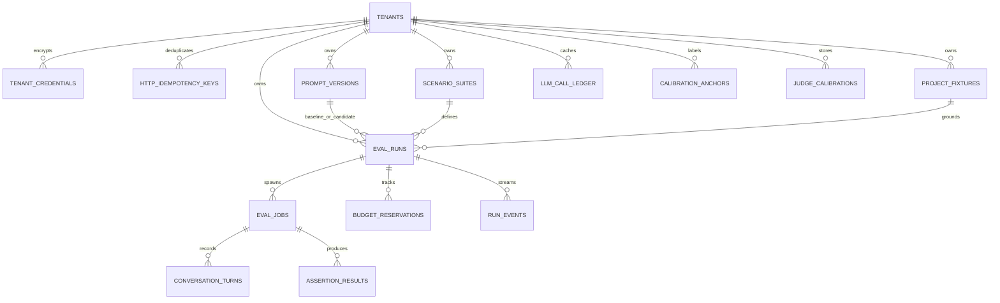

# 11 — Database & Data Design

PropEval uses **PostgreSQL 17.12** (`asyncpg 0.32.0`, SQLAlchemy `2.1.9`, Alembic `1.20.1`) with a **hybrid relational + JSONB** schema: every field used for filtering, statistical aggregation, cost control, or locking lives in strongly typed indexed relational columns, while variable nested payloads live in `schema_version`-tagged `JSONB`.

---

## 1. Entity-Relationship Diagram



---

## 2. Complete SQL Design Specification (DDL)

```sql
-- 1. Tenants & Encrypted BYOK Credentials / API Keys
CREATE TABLE tenants (
    id UUID PRIMARY KEY DEFAULT gen_random_uuid(),
    name TEXT NOT NULL,
    data_region TEXT NOT NULL DEFAULT 'ap-south-1',
    encrypted_dek BYTEA NOT NULL,                 -- AES-256-GCM DEK wrapped by Cloud KMS CMK
    created_at TIMESTAMPTZ NOT NULL DEFAULT now()
);

CREATE TABLE tenant_credentials (
    id UUID PRIMARY KEY DEFAULT gen_random_uuid(),
    tenant_id UUID NOT NULL REFERENCES tenants(id) ON DELETE CASCADE,
    credential_type TEXT NOT NULL CHECK (credential_type IN ('propeval_api_key', 'byok_llm_key', 'webhook_hmac_secret')),
    provider_name TEXT,                           -- 'openai' | 'google' | 'groq' | 'anthropic' | NULL
    key_hash CHAR(64),                            -- Salted SHA-256 for propeval_api_key lookup
    encrypted_secret BYTEA,                       -- AES-256-GCM ciphertext using tenant DEK
    target_webhook_url TEXT,
    created_at TIMESTAMPTZ NOT NULL DEFAULT now(),
    revoked_at TIMESTAMPTZ
);

-- 2. HTTP IETF Idempotency-Key Store (24h TTL)
CREATE TABLE http_idempotency_keys (
    tenant_id UUID NOT NULL REFERENCES tenants(id) ON DELETE CASCADE,
    idempotency_key TEXT NOT NULL,
    request_sha256 CHAR(64) NOT NULL,
    response_status SMALLINT NOT NULL,
    response_body JSONB NOT NULL,
    created_at TIMESTAMPTZ NOT NULL DEFAULT now(),
    expires_at TIMESTAMPTZ NOT NULL DEFAULT now() + interval '24 hours',
    PRIMARY KEY (tenant_id, idempotency_key)
);

-- 3. Immutable Prompt Registry (with lifecycle status)
CREATE TABLE prompt_versions (
    id UUID PRIMARY KEY DEFAULT gen_random_uuid(),
    tenant_id UUID NOT NULL REFERENCES tenants(id) ON DELETE CASCADE,
    name TEXT NOT NULL,
    version_tag TEXT NOT NULL,
    parent_version_id UUID REFERENCES prompt_versions(id),
    status TEXT NOT NULL DEFAULT 'REGISTERED'
        CHECK (status IN ('DRAFT','REGISTERED','CANDIDATE_EVALUATING','GATED_PASS','GATED_REGRESSED','PRODUCTION_BASELINE','ARCHIVED')),
    system_prompt TEXT NOT NULL,
    model_provider TEXT NOT NULL,                 -- 'openai' | 'google' | 'groq' | 'anthropic'
    model_id TEXT NOT NULL,
    temperature NUMERIC(3,2) NOT NULL DEFAULT 0.30,
    tools_schema JSONB NOT NULL DEFAULT '[]'::jsonb,
    content_sha256 CHAR(64) NOT NULL,
    created_at TIMESTAMPTZ NOT NULL DEFAULT now(),
    UNIQUE (tenant_id, content_sha256)
);

-- 4. Versioned Real Estate Property Truth Fixtures
CREATE TABLE project_fixtures (
    id UUID PRIMARY KEY DEFAULT gen_random_uuid(),
    tenant_id UUID NOT NULL REFERENCES tenants(id) ON DELETE CASCADE,
    project_name TEXT NOT NULL,
    city TEXT NOT NULL,
    rera_id TEXT NOT NULL,
    effective_from DATE NOT NULL,
    supersedes_id UUID REFERENCES project_fixtures(id),
    facts_json JSONB NOT NULL,                    -- schema_version, carpet_area, price_bands_inr, floor_rise, possession
    content_sha256 CHAR(64) NOT NULL,
    created_at TIMESTAMPTZ NOT NULL DEFAULT now(),
    UNIQUE (tenant_id, project_name, effective_from),
    UNIQUE (tenant_id, content_sha256)
);

-- 5. Immutable Stratified Scenario Suites
CREATE TABLE scenario_suites (
    id UUID PRIMARY KEY DEFAULT gen_random_uuid(),
    tenant_id UUID NOT NULL REFERENCES tenants(id) ON DELETE CASCADE,
    name TEXT NOT NULL,
    suite_tier TEXT NOT NULL CHECK (suite_tier IN ('smoke_pr', 'release_gate', 'metamorphic', 'canary_spc')),
    version_tag TEXT NOT NULL,
    scenarios_json JSONB NOT NULL,
    scenario_count INT NOT NULL CHECK (scenario_count > 0),
    content_sha256 CHAR(64) NOT NULL,
    created_at TIMESTAMPTZ NOT NULL DEFAULT now(),
    UNIQUE (tenant_id, name, version_tag)
);

-- 6. Evaluation Runs (Paired V1 vs V2 Experiments + Reproducibility Hashes)
CREATE TABLE eval_runs (
    id UUID PRIMARY KEY DEFAULT gen_random_uuid(),
    tenant_id UUID NOT NULL REFERENCES tenants(id) ON DELETE CASCADE,
    baseline_prompt_id UUID NOT NULL REFERENCES prompt_versions(id),
    candidate_prompt_id UUID NOT NULL REFERENCES prompt_versions(id),
    suite_id UUID NOT NULL REFERENCES scenario_suites(id),
    fixture_id UUID NOT NULL REFERENCES project_fixtures(id),
    grader_prompt_sha256 CHAR(64) NOT NULL,       -- NFR-12 reproducibility
    trials_k SMALLINT NOT NULL DEFAULT 1 CHECK (trials_k BETWEEN 1 AND 10),
    random_seed INT NOT NULL DEFAULT 42,
    simulator_model_id TEXT NOT NULL,
    judge_model_id TEXT NOT NULL,
    status TEXT NOT NULL DEFAULT 'QUEUED'
        CHECK (status IN ('QUEUED','RUNNING','COMPUTING_STATS','PASSED','REGRESSED',
                          'INCONCLUSIVE_UNDERPOWERED','BUDGET_EXCEEDED','EARLY_ABORTED_HARM','FAILED')),
    max_budget_usd NUMERIC(10,4) NOT NULL CHECK (max_budget_usd > 0),
    spent_usd NUMERIC(10,4) NOT NULL DEFAULT 0.0000 CHECK (spent_usd >= 0),
    summary_stats JSONB,
    created_at TIMESTAMPTZ NOT NULL DEFAULT now(),
    completed_at TIMESTAMPTZ
);

-- 7. Per-Job / Per-Call Budget Reservations (Zero Permanent Leaks on Worker Crash)
CREATE TABLE budget_reservations (
    id UUID PRIMARY KEY DEFAULT gen_random_uuid(),
    tenant_id UUID NOT NULL REFERENCES tenants(id) ON DELETE CASCADE,
    run_id UUID NOT NULL REFERENCES eval_runs(id) ON DELETE CASCADE,
    job_id UUID NOT NULL,
    fence_token BIGINT NOT NULL,
    reserved_usd NUMERIC(10,6) NOT NULL CHECK (reserved_usd > 0),
    status TEXT NOT NULL DEFAULT 'ACTIVE' CHECK (status IN ('ACTIVE', 'SETTLED', 'RELEASED')),
    created_at TIMESTAMPTZ NOT NULL DEFAULT now()
);

-- 8. Transactional Job Queue (FOR UPDATE SKIP LOCKED + Lease + Fence Token)
CREATE TABLE eval_jobs (
    id UUID PRIMARY KEY DEFAULT gen_random_uuid(),
    tenant_id UUID NOT NULL REFERENCES tenants(id) ON DELETE CASCADE,
    run_id UUID NOT NULL REFERENCES eval_runs(id) ON DELETE CASCADE,
    scenario_id TEXT NOT NULL,
    prompt_role TEXT NOT NULL CHECK (prompt_role IN ('baseline', 'candidate')),
    prompt_version_id UUID NOT NULL REFERENCES prompt_versions(id),
    trial_index SMALLINT NOT NULL DEFAULT 0,
    priority SMALLINT NOT NULL DEFAULT 10,
    status TEXT NOT NULL DEFAULT 'QUEUED'
        CHECK (status IN ('QUEUED','RUNNING','COMPLETED','QUARANTINED_SIM_FAULT','DEAD_LETTERED')),
    worker_id TEXT,
    fence_token BIGINT NOT NULL DEFAULT 0,
    attempt SMALLINT NOT NULL DEFAULT 0,
    max_attempts SMALLINT NOT NULL DEFAULT 5,
    run_after TIMESTAMPTZ NOT NULL DEFAULT now(),
    lease_expires_at TIMESTAMPTZ,
    overall_pass BOOLEAN,
    hard_gate_pass BOOLEAN,
    extraction_f1 NUMERIC(5,4),
    p50_ttft_ms INT,
    p95_ttft_ms INT,
    total_tokens INT DEFAULT 0,
    cost_usd NUMERIC(10,6) DEFAULT 0,
    mock_db_state_hash CHAR(64),
    last_error_code TEXT,
    last_error_detail TEXT,
    created_at TIMESTAMPTZ NOT NULL DEFAULT now(),
    updated_at TIMESTAMPTZ NOT NULL DEFAULT now(),
    UNIQUE (run_id, scenario_id, prompt_role, trial_index)
);

-- 9. Durable SSE Event Log (Enables True Last-Event-ID Resumption)
CREATE TABLE run_events (
    event_id BIGSERIAL PRIMARY KEY,
    tenant_id UUID NOT NULL REFERENCES tenants(id) ON DELETE CASCADE,
    run_id UUID NOT NULL REFERENCES eval_runs(id) ON DELETE CASCADE,
    event_type TEXT NOT NULL CHECK (event_type IN ('job.completed','job.quarantined','run.budget_halted','run.early_aborted','run.completed')),
    payload JSONB NOT NULL,
    created_at TIMESTAMPTZ NOT NULL DEFAULT now()
);

-- 10. Normalized Conversation Turns
CREATE TABLE conversation_turns (
    id BIGSERIAL PRIMARY KEY,
    tenant_id UUID NOT NULL REFERENCES tenants(id) ON DELETE CASCADE,
    job_id UUID NOT NULL REFERENCES eval_jobs(id) ON DELETE CASCADE,
    turn_index SMALLINT NOT NULL,
    fsm_state TEXT NOT NULL,
    buyer_raw_text TEXT NOT NULL,
    buyer_perturbed_text TEXT NOT NULL,
    agent_text TEXT NOT NULL,
    tool_calls JSONB NOT NULL DEFAULT '[]'::jsonb,
    tool_outcomes JSONB NOT NULL DEFAULT '[]'::jsonb,
    ttft_ms INT,
    total_ms INT,
    input_tokens INT NOT NULL DEFAULT 0,
    output_tokens INT NOT NULL DEFAULT 0,
    cost_usd NUMERIC(10,6) NOT NULL DEFAULT 0,
    created_at TIMESTAMPTZ NOT NULL DEFAULT now(),
    UNIQUE (job_id, turn_index)
);

-- 11. Normalized Assertion & Rubric Results
CREATE TABLE assertion_results (
    id BIGSERIAL PRIMARY KEY,
    tenant_id UUID NOT NULL REFERENCES tenants(id) ON DELETE CASCADE,
    job_id UUID NOT NULL REFERENCES eval_jobs(id) ON DELETE CASCADE,
    layer TEXT NOT NULL CHECK (layer IN ('deterministic', 'metamorphic', 'fact_grounding', 'rubric_judge', 'sim_audit')),
    metric_name TEXT NOT NULL,
    passed BOOLEAN NOT NULL,
    score NUMERIC(6,4),
    failure_stage TEXT CHECK (failure_stage IN (
        'ASR_NOISE','SLOT_EXTRACT','KB_RETRIEVAL','FACT_HALLUCINATION','TOOL_CONTRACT','TONE_REGISTER','SIMULATOR_FAULT'
    )),
    judge_model_id TEXT,
    rationale_json JSONB,
    created_at TIMESTAMPTZ NOT NULL DEFAULT now()
);

-- 12. Idempotent LLM Call Ledger
CREATE TABLE llm_call_ledger (
    tenant_id UUID NOT NULL REFERENCES tenants(id) ON DELETE CASCADE,
    idempotency_key CHAR(64) NOT NULL,
    status TEXT NOT NULL CHECK (status IN ('PENDING', 'COMPLETED', 'FAILED')),
    provider TEXT NOT NULL,
    model_id TEXT NOT NULL,
    response_payload JSONB,
    input_tokens INT,
    output_tokens INT,
    cost_usd NUMERIC(10,6),
    created_at TIMESTAMPTZ NOT NULL DEFAULT now(),
    PRIMARY KEY (tenant_id, idempotency_key)
);

-- 13. Human Golden Anchors & Persisted Judge Calibrations
CREATE TABLE calibration_anchors (
    id UUID PRIMARY KEY DEFAULT gen_random_uuid(),
    tenant_id UUID NOT NULL REFERENCES tenants(id) ON DELETE CASCADE,
    rubric_name TEXT NOT NULL,
    prompt_version_id UUID REFERENCES prompt_versions(id),
    redacted_transcript JSONB NOT NULL,
    human_label BOOLEAN NOT NULL,
    annotator_id TEXT NOT NULL,
    created_at TIMESTAMPTZ NOT NULL DEFAULT now()
);

CREATE TABLE judge_calibrations (
    id UUID PRIMARY KEY DEFAULT gen_random_uuid(),
    tenant_id UUID NOT NULL REFERENCES tenants(id) ON DELETE CASCADE,
    rubric_name TEXT NOT NULL,
    judge_model_id TEXT NOT NULL,
    prompt_version_id UUID REFERENCES prompt_versions(id),
    sample_size INT NOT NULL,
    cohens_kappa NUMERIC(5,4) NOT NULL,
    tpr NUMERIC(5,4) NOT NULL,
    tnr NUMERIC(5,4) NOT NULL,
    fail_precision NUMERIC(5,4) NOT NULL,
    fail_recall NUMERIC(5,4) NOT NULL,
    calibration_status TEXT NOT NULL CHECK (calibration_status IN ('CALIBRATED', 'UNCALIBRATED_ADVISORY_ONLY')),
    created_at TIMESTAMPTZ NOT NULL DEFAULT now()
);
```

---

## 3. Split Partial Indexes, Claim SQL & Multi-Tenant RLS Pattern

### Split Partial Indexes (Matching Exact Query Predicates)
```sql
-- Index 1: Fast dequeue of queued jobs
CREATE INDEX idx_eval_jobs_queued
    ON eval_jobs (priority DESC, run_after ASC)
    WHERE status = 'QUEUED';

-- Index 2: Fast lease reclamation of expired running jobs
CREATE INDEX idx_eval_jobs_expired_lease
    ON eval_jobs (lease_expires_at ASC)
    WHERE status = 'RUNNING';

-- Index 3: Active reservations per run (avoids hot-row UPDATE contention on eval_runs)
CREATE INDEX idx_budget_res_active ON budget_reservations (run_id) WHERE status = 'ACTIVE';

-- Index 4: Fast SSE Last-Event-ID replay
CREATE INDEX idx_run_events_stream ON run_events (run_id, event_id ASC);

-- Index 5: Paired diff aggregations & GIN on project fixtures
CREATE INDEX idx_eval_jobs_run_pair ON eval_jobs (run_id, scenario_id, prompt_role);
CREATE INDEX idx_assertion_results_job_layer ON assertion_results (job_id, layer, metric_name);
CREATE INDEX idx_project_fixtures_facts_gin
    ON project_fixtures USING GIN (facts_json jsonb_path_ops) WITH (fastupdate = off);
```

### Solving `FORCE RLS` + Shared Multi-Tenant Worker Pool & Fairness
Applying `FORCE ROW LEVEL SECURITY` to `eval_jobs` prevents a shared cross-tenant worker from seeing any rows unless claiming occurs via a tightly scoped **`SECURITY DEFINER` function** owned by a dedicated `propeval_queue_owner` role. The function also enforces **per-tenant active-job caps** (preventing noisy-neighbor starvation) and immediately releases stale `budget_reservations` when reclaiming an expired lease:

```sql
-- Safe RLS Policy (handles empty-string GUC reset cleanly via NULLIF)
ALTER TABLE eval_runs ENABLE ROW LEVEL SECURITY;
ALTER TABLE eval_runs FORCE ROW LEVEL SECURITY;
CREATE POLICY tenant_isolation_eval_runs ON eval_runs
    USING (tenant_id = NULLIF(current_setting('app.current_tenant_id', true), '')::uuid);
-- (Applied identically across all tenant-scoped tables.)

-- Cross-tenant claim function (SECURITY DEFINER): claims 1 job with per-tenant fairness cap
CREATE OR REPLACE FUNCTION claim_next_eval_job(p_worker_id TEXT, p_lease_sec INT, p_max_per_tenant INT DEFAULT 20)
RETURNS SETOF eval_jobs
LANGUAGE plpgsql SECURITY DEFINER AS $$
DECLARE
    v_job eval_jobs%ROWTYPE;
BEGIN
    WITH active_counts AS (
        SELECT tenant_id, COUNT(*) AS active_n FROM eval_jobs WHERE status = 'RUNNING' GROUP BY tenant_id
    ),
    candidate AS (
        SELECT j.id FROM eval_jobs j
        LEFT JOIN active_counts ac ON ac.tenant_id = j.tenant_id
        WHERE (j.status = 'QUEUED' AND j.run_after <= now() AND COALESCE(ac.active_n, 0) < p_max_per_tenant)
           OR (j.status = 'RUNNING' AND j.lease_expires_at < now())
        ORDER BY j.priority DESC, j.run_after ASC
        FOR UPDATE OF j SKIP LOCKED
        LIMIT 1
    )
    UPDATE eval_jobs j
    SET status = 'RUNNING',
        worker_id = p_worker_id,
        fence_token = j.fence_token + 1,
        attempt = j.attempt + 1,
        lease_expires_at = now() + make_interval(secs => p_lease_sec),
        updated_at = now()
    FROM candidate c
    WHERE j.id = c.id
    RETURNING j.* INTO v_job;

    IF FOUND THEN
        -- Release any orphaned ACTIVE budget reservations from crashed prior fence_token
        UPDATE budget_reservations
        SET status = 'RELEASED'
        WHERE job_id = v_job.id AND fence_token < v_job.fence_token AND status = 'ACTIVE';
        RETURN NEXT v_job;
    END IF;
END;
$$;
```
Immediately after `claim_next_eval_job` returns `v_job`, the worker opens tenant-scoped transactions with `SET LOCAL app.current_tenant_id = v_job.tenant_id` so every subsequent turn write, ledger lookup, and assertion insert runs under strict `FORCE ROW LEVEL SECURITY`.

* **Autovacuum Tuning:** Apply aggressive autovacuum (`autovacuum_vacuum_scale_factor = 0.02`) to **`eval_jobs`**, **`budget_reservations`**, and **`eval_runs`**.
